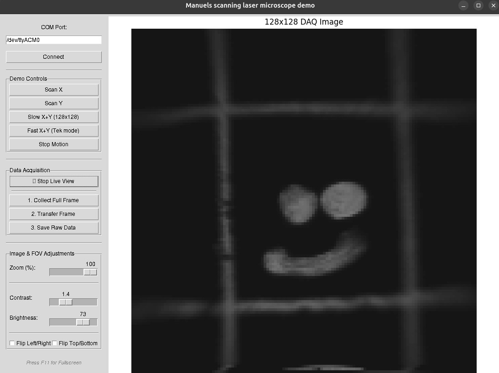

# ScopeDAQ
 A simple DAQ system for a laser scanning microscope. Should look like this:

# Method

Upload code to Arduino Due.

Wire up x and y scan signals and intensity to three analog inputs.

Then connect Arduino to Laptop, and start python GUI

# Hardware:

Any old scan, tube, and objective lens will do. The Arduino due outputs need amplification to drive the galvos. Any old OpAmp will do. For detection, it is strategic to to do de-scanned through a pinhole. That helps with ambient light during demo days.
